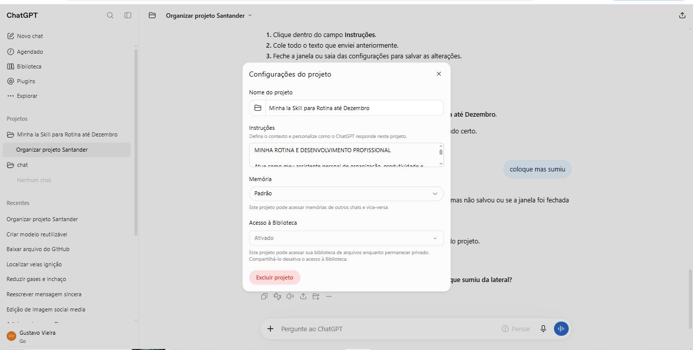
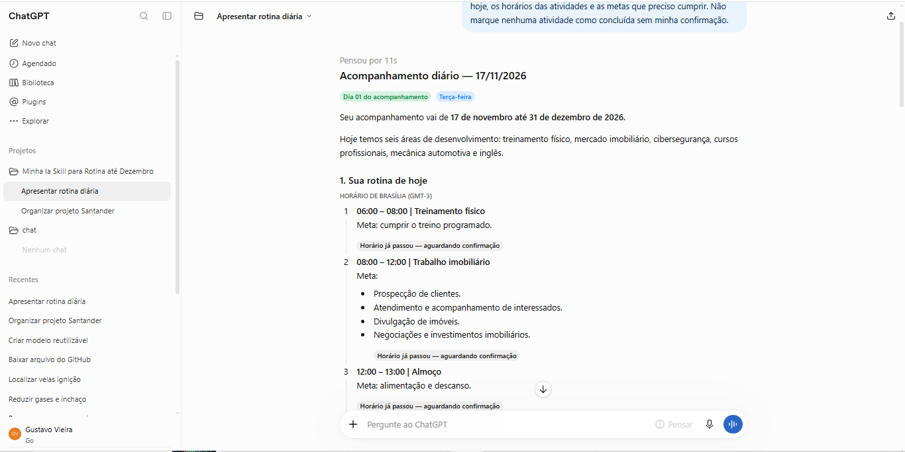
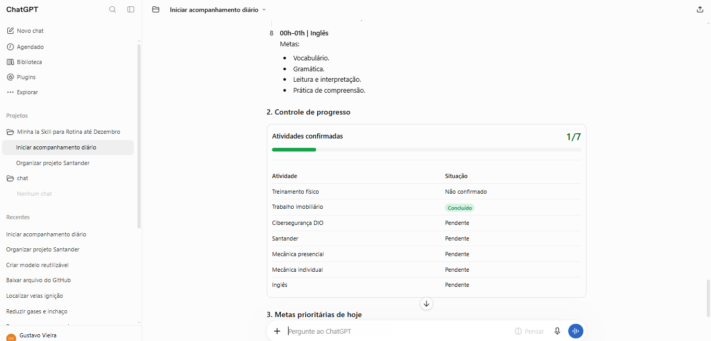

Minha Entrega — Meu Kit de IA

## 1. Sobre o projeto

Este projeto apresenta minha experiência utilizando Inteligência Artificial para organizar minha rotina pessoal, profissional e educacional.

O objetivo foi utilizar um agente de IA para planejar meus horários, organizar minhas atividades e acompanhar meu desenvolvimento entre 17/11/2026 e 31/12/2026.

## 2. Problema identificado

Eu precisava organizar diferentes áreas da minha rotina, conciliando trabalho, estudos e desenvolvimento pessoal.

Minhas principais atividades são:

Trabalho com vendas e investimentos imobiliários.

Cibersegurança — DIO.

Programação — DIO.

Cursos Santander e Bradesco.

Mecânica automotiva — Escola do Mecânico.

Inglês.

Treinamento físico.

O desafio era distribuir essas atividades em horários definidos, mantendo uma organização diária e semanal.

3. Ferramentas utilizadas

ChatGPT: planejamento, organização e acompanhamento das atividades.

Projetos do ChatGPT: armazenamento de instruções e organização das conversas.

Google Agenda: cadastro dos compromissos recorrentes e visualização da rotina.

## 4. Atalho de IA — Planejador de Rotina

4.1. Contexto

Este atalho foi desenvolvido para organizar e acompanhar minha rotina pessoal, profissional e educacional durante o período definido.

4.2. Instrução

Atue como meu assistente pessoal de organização, produtividade e desenvolvimento profissional.

Utilize minha rotina como referência. Apresente minhas atividades conforme o dia da semana, respeitando os horários e as prioridades estabelecidas.

4.3. Rotina de segunda a sexta-feira

Horário

Atividade

06h às 08h

Treinamento físico

08h às 12h

Trabalho imobiliário

12h às 13h

Almoço

13h30 às 15h30

Cibersegurança — DIO

15h30 às 17h30

Cursos em rodízio

18h

Preparação e deslocamento para a Escola do Mecânico

19h às 22h

Aula presencial de mecânica (segunda a quinta)

23h às 00h

Estudo individual de mecânica

00h às 01h

Inglês

4.4. Rotina de sábado e domingo

Horário

Atividade

06h às 08h

Treinamento físico

11h às 12h

Inglês

12h às 13h

Almoço

13h30 às 15h30

Cibersegurança — DIO

15h30 às 17h30

Cursos em rodízio

Nos finais de semana não há trabalho imobiliário, aula presencial de mecânica ou estudo individual de mecânica.

4.5. Rodízio dos cursos

Segunda-feira: DIO — Programação.

Terça-feira: Santander.

Quarta-feira: Bradesco.

Quinta-feira: DIO — Programação.

Sexta-feira: Santander.

Sábado: Bradesco.

Domingo: revisão ou continuidade do curso com menor progresso.

4.6. Objetivo

Manter disciplina e organização, acompanhar o cumprimento das atividades, identificar atrasos e organizar metas diárias e semanais.

4.7. Formato da resposta

Ao iniciar o acompanhamento diário, o agente deverá apresentar:

Data e dia da semana.

Agenda completa do dia.

Horários das atividades.

Metas que precisam ser cumpridas.

Situação das atividades: pendente, concluída ou atrasada.

Ao finalizar o dia, deverá apresentar um resumo do progresso informado.

4.8. Limites e regras

Nunca marcar uma atividade como concluída sem minha confirmação.

Não inventar atividades realizadas.

Não modificar horários sem minha autorização.

Não excluir atividades da rotina por conta própria.

Identificar atrasos e sugerir reorganizações, aguardando autorização.

Explicar conteúdos técnicos de maneira didática quando solicitado.

Diferenciar eventos do Google Agenda de lembretes automáticos do ChatGPT.

Não afirmar que uma notificação foi enviada sem confirmação.

4.9. Arquivo do atalho

O atalho completo está documentado no seguinte arquivo:

atalhos/01-planejador-de-rotina.md

## 5. Delegação de tarefa ao agente de IA

5.1. Solicitação

Organizar minha rotina de estudos, trabalho e desenvolvimento pessoal entre 17/11/2026 e 31/12/2026.

5.2. Planejamento

O agente analisou as atividades, os horários e as prioridades informadas.

A partir dessas informações, organizou a rotina semanal, distribuiu os cursos em rodízio e estruturou as atividades de acordo com os dias da semana.

5.3. Execução

Durante a execução:

Criei um Projeto no ChatGPT.

Configurei instruções específicas para o acompanhamento da rotina.

Organizei uma nova conversa para testar o planejamento.

Conectei o Google Agenda.

Autorizei a criação dos compromissos recorrentes.

Mantive o lembrete das 18h para preparação e deslocamento à Escola do Mecânico, que já estava configurado.

5.4. Resultado verificado

Foram criados 12 compromissos recorrentes no Google Agenda, contemplando treinamento físico, trabalho, almoço, cibersegurança, cursos, mecânica e inglês.

Também realizei um teste do Planejador de Rotina no ChatGPT, verificando a apresentação da agenda diária e o acompanhamento das atividades.

O teste permitiu observar a organização das tarefas e seus respectivos estados de progresso.

## 6. Evidências da execução

As imagens abaixo documentam as etapas de criação, configuração, planejamento e teste do projeto.

6.1. Criação do atalho no GitHub

O atalho foi documentado em um arquivo Markdown dentro da pasta atalhos.

### 6.2. Configuração do projeto ChatGPT

### 6.3. Planejamento semanal no Google Agenda

### 6.4. Planejamento diário apresentado pelo ChatGPT

### 6.5. Teste do acompanhamento

### 6.6. Evidências complementares

## 7.  Aprendizados

A experiência demonstrou como a Inteligência Artificial pode auxiliar na organização de tarefas, no planejamento de horários e no acompanhamento de objetivos.

Aprendi a importância de:

Fornecer instruções claras ao agente.

Definir objetivos e limites.

Validar os resultados apresentados.

Utilizar ferramentas integradas para organizar atividades.

Manter o controle humano sobre as decisões.

Projeto desenvolvido como parte do desafio Meu Kit de IA — DIO.
